# Design: FinTrack P0 – Core MVP (and whole-product architecture)

## Context

The repository contains only `openspec/` (no code, not yet a Git repo). See proposal.md for motivation and roadmap. Because P0 sets the foundation for P1–P3, this design defines the **whole-product architecture and data model**; P1–P3 designs only extend it. Requirements live in this change's `specs/`.

Constraints: single repository; React + TypeScript frontend; FastAPI + SQLAlchemy + PostgreSQL backend; modular monolith; INR reporting; exact decimal money; the app must work with no external APIs configured (market data, FX, LLM, SMTP in production).

## Goals / Non-Goals

**Goals:**
- A layered backend where business rules and financial math are isolated from HTTP and persistence, so every figure has one implementation.
- A data model that P1–P3 extend with new tables, not by restructuring P0 tables.
- One-command local environment (`docker compose up`) and CI running lint, type-check, tests and migrations.

**Non-Goals:**
- Horizontal scale, multi-region, microservices, event sourcing.
- Multi-currency reporting, households/shared accounts, bank aggregation.
- Native mobile apps (responsive web only).

## Decisions

### D1. Repository layout (monorepo at current root)

```text
./                        (repo root; currently "Expense-Tracker")
├── openspec/             specs/, changes/, config.yaml
├── frontend/             Vite React TS app
│   └── src/{app,components/ui,components/charts,features/<domain>,layouts,pages,hooks,services/api,lib,types}
├── backend/
│   ├── app/
│   │   ├── api/v1/<domain>.py      routers: HTTP only (parse, auth dependency, call service, map response)
│   │   ├── core/                   config, security (hashing, JWT), logging, errors, rate limiting, db session
│   │   ├── models/                 SQLAlchemy ORM models
│   │   ├── schemas/                Pydantic request/response models
│   │   ├── services/<domain>/      business logic, transactions boundaries, audit calls
│   │   ├── services/calculations/  pure functions: savings, rates, (P1) EMI, net worth, (P2) returns, FX split
│   │   ├── repositories/           query objects, always scoped by user_id
│   │   ├── integrations/           storage, email, (P2) market data, FX, (P3) LLM — each behind a Protocol
│   │   └── tasks/                  (P1+) background jobs
│   ├── alembic/  tests/{unit,integration}/  pyproject.toml
├── infrastructure/       Dockerfiles, nginx config, (later) deploy manifests
├── docs/                 architecture.md, financial-calculations.md, api.md, runbook.md
├── docker-compose.yml  .env.example  .gitignore  README.md  .github/workflows/ci.yml
```

`backend/pyproject.toml` (managed with uv) replaces the brief's `requirements.txt`; a `requirements.txt` lock export is generated for tooling that needs it. *Alternative*: nested `fintrack/` directory — rejected, the OpenSpec root is already the repo root.

### D2. Backend layering and module boundaries
Routers → services → repositories → models. Calculations are **pure functions** taking Decimals/dataclasses (no DB access), unit-tested exhaustively and reused by reports, dashboard, exports and the P3 AI assistant. Each domain (`auth`, `users`, `accounts`, `categories`, `transactions`, `income`, `dashboard`, `reports`; later `budgets`, `goals`, `networth`, `loans`, `investments`, `marketdata`, `fx`, `recurring`, `assistant`, `notifications`) is a package; cross-domain calls go through service interfaces, never another domain's repository. *Alternative*: fat routers with ORM calls — rejected (untestable math, duplicated rules).

### D3. Money representation
- DB: `NUMERIC(19,4)` for amounts (2 dp enforced by validation for INR/USD; 4 dp headroom for FX-converted values), `NUMERIC(20,8)` for quantities and prices of securities, `NUMERIC(18,8)` for FX rates, `NUMERIC(9,6)` for interest rates.
- Python: `decimal.Decimal` with a project context (precision 28, `ROUND_HALF_UP`); Pydantic `condecimal` and a custom serializer emitting strings.
- Frontend: amounts stay strings; display via `Intl.NumberFormat('en-IN')` on the string-parsed value only for formatting; no arithmetic in the browser.
- Every amount column has a sibling `currency CHAR(3)`.

### D4. Unified transaction ledger
A single `transactions` table with a `type` enum (`income`, `expense`, `transfer`, `refund`; P1 `loan_payment`; P2 `investment_buy`, `investment_sell`, `dividend`). Transfers store `account_id` (source) and `counter_account_id` (destination) in one row. Balances are derived (`opening_balance + Σ signed amounts`) with a covering index; a materialized running balance is deferred until profiling demands it. Sign rules live in one function `signed_effect(txn, account)`. *Alternative*: double-entry ledger with journal lines — more rigorous but heavier for users and UI; the typed single-row model plus explicit "what counts as expense" rules (spec `financial-calculations`) gives the needed correctness. Revisit if P2 accounting proves awkward.

### D5. Authentication
Argon2id (`argon2-cffi`) password hashing; access JWT (HS256 in P0, 15 min, claims `sub`, `exp`, `jti`) held in frontend memory; opaque refresh token (random 256-bit, stored hashed in `refresh_tokens` with `family_id`) in an httpOnly Secure SameSite=Strict cookie scoped to `/api/v1/auth`. Rotation with reuse detection revokes the family. *Alternatives*: access token in localStorage — rejected (XSS exfiltration); server sessions — viable but JWT was requested. Password reset tokens: random, hashed, 30 min TTL, emailed via SMTP (Mailpit locally).

### D6. Data isolation
Every user-owned table has `user_id NOT NULL` with an index; repositories require `user_id` in their constructor and add it to every query. Integration tests include a cross-tenant suite that hits each endpoint as a second user. PostgreSQL Row-Level Security is noted as future hardening (open question).

### D7. API conventions
`/api/v1/<domain>`; envelope `{data, meta}` / `{error}`; `page`/`page_size`; filter params named per spec; sort via `sort=-date` with per-endpoint allow-lists; idempotency key header (`Idempotency-Key`) accepted on POST for transactions and imports to make retries safe. OpenAPI generated by FastAPI; frontend types generated from it (`openapi-typescript`) to prevent drift.

**P0 endpoint plan**

| Domain | Endpoints |
|---|---|
| health | `GET /health/live`, `GET /health/ready` |
| auth | `POST /auth/register`, `/auth/login`, `/auth/refresh`, `/auth/logout`, `/auth/password-reset/request`, `/auth/password-reset/confirm`, `/auth/password/change` |
| users | `GET/PATCH /users/me`, `GET/PATCH /users/me/preferences`, `DELETE /users/me` |
| accounts | `GET/POST /accounts`, `GET/PATCH/DELETE /accounts/{id}`, `POST /accounts/{id}/archive`, `GET /accounts/summary` |
| categories | `GET/POST /categories`, `PATCH/DELETE /categories/{id}` (DELETE takes `replacement_id`) |
| transactions | `GET/POST /transactions`, `GET/PATCH/DELETE /transactions/{id}`, `POST /transactions/duplicate-check`, `GET /transactions/export.csv` |
| attachments | `POST /transactions/{id}/attachments`, `GET/DELETE /attachments/{id}` |
| imports | `POST /imports` (upload → preview), `GET /imports/{id}`, `POST /imports/{id}/confirm`, `POST /imports/{id}/undo` |
| income | `GET/POST /income-sources`, `PATCH /income-sources/{id}`, `GET /reports/income` |
| dashboard | `GET /dashboard/overview?period=…`, `GET /dashboard/trends?months=12`, `GET /dashboard/category-breakdown` |
| reports | `GET /reports/expenses`, `GET /reports/savings-trend`, `…/export.csv` |

### D8. Data model (whole product)
Release tag in brackets. All tables have `id UUID PK`, `created_at`, `updated_at`; user-owned tables have `user_id FK`.

```mermaid
erDiagram
    USERS ||--|| USER_PREFERENCES : has
    USERS ||--o{ REFRESH_TOKENS : has
    USERS ||--o{ PASSWORD_RESET_TOKENS : has
    USERS ||--o{ ACCOUNTS : owns
    USERS ||--o{ CATEGORIES : owns
    USERS ||--o{ INCOME_SOURCES : owns
    USERS ||--o{ TRANSACTIONS : owns
    USERS ||--o{ AUDIT_LOG : "acts in"
    CATEGORIES ||--o{ CATEGORIES : "parent of"
    ACCOUNTS ||--o{ TRANSACTIONS : "source"
    ACCOUNTS ||--o{ TRANSACTIONS : "counter (transfers)"
    CATEGORIES ||--o{ TRANSACTIONS : classifies
    INCOME_SOURCES ||--o{ TRANSACTIONS : "income from"
    TRANSACTIONS ||--o{ SALARY_COMPONENTS : "breakdown"
    TRANSACTIONS ||--o{ ATTACHMENTS : has
    IMPORT_BATCHES ||--o{ TRANSACTIONS : created
    USERS ||--o{ IMPORT_BATCHES : owns

    USERS ||--o{ BUDGETS : "P1"
    BUDGETS ||--o{ BUDGET_LINES : "P1 per category"
    USERS ||--o{ SAVINGS_TARGETS : "P1"
    USERS ||--o{ GOALS : "P1"
    GOALS ||--o{ GOAL_CONTRIBUTIONS : "P1"
    USERS ||--o{ ASSETS : "P1"
    ASSETS ||--o{ ASSET_VALUATIONS : "P1"
    USERS ||--o{ LIABILITIES : "P1"
    USERS ||--o{ LOANS : "P1"
    LOANS ||--|| LIABILITIES : "P1 tracked as"
    LOANS ||--o{ LOAN_SCHEDULE_ENTRIES : "P1"
    LOANS ||--o{ LOAN_PAYMENTS : "P1"
    LOAN_PAYMENTS ||--|| TRANSACTIONS : "P1 recorded as"
    USERS ||--o{ NET_WORTH_SNAPSHOTS : "P1"

    USERS ||--o{ INVESTMENT_ACCOUNTS : "P2"
    SECURITIES ||--o{ INVESTMENT_TRANSACTIONS : "P2"
    INVESTMENT_ACCOUNTS ||--o{ INVESTMENT_TRANSACTIONS : "P2"
    INVESTMENT_ACCOUNTS ||--o{ HOLDINGS : "P2 derived"
    SECURITIES ||--o{ MARKET_PRICES : "P2"
    SECURITIES ||--o{ CORPORATE_ACTIONS : "P2"
    EXCHANGE_RATES }o--|| CURRENCY_PAIRS : "P2"

    USERS ||--o{ RECURRING_RULES : "P3"
    RECURRING_RULES ||--o{ RECURRING_OCCURRENCES : "P3"
    RECURRING_OCCURRENCES |o--o| TRANSACTIONS : "P3 confirmed as"
    USERS ||--o{ NOTIFICATIONS : "P3"
    USERS ||--o{ ALERT_RULES : "P3"
    USERS ||--o{ AI_CONVERSATIONS : "P3"
    AI_CONVERSATIONS ||--o{ AI_MESSAGES : "P3"
```



**P0 tables (detail)**

| Table | Key columns / constraints |
|---|---|
| `users` | `email CITEXT UNIQUE`, `password_hash`, `full_name`, `is_active`, `deleted_at` |
| `user_preferences` | `user_id UNIQUE`, `currency='INR'`, `theme`, `locale`, `date_format`, `number_grouping`, `timezone='Asia/Kolkata'` |
| `refresh_tokens` | `token_hash UNIQUE`, `family_id`, `expires_at`, `revoked_at`, `replaced_by` |
| `password_reset_tokens` | `token_hash UNIQUE`, `expires_at`, `used_at` |
| `accounts` | `name`, `type` enum, `institution`, `last4 CHAR(4)`, `currency`, `opening_balance NUMERIC(19,4)`, `opening_date`, `archived_at`; unique (`user_id`, lower(`name`)) |
| `categories` | `kind` enum, `name`, `parent_id` (self FK, depth ≤ 1 enforced in service + trigger), `color`, `icon`, `is_essential`, `is_system`; unique (`user_id`, `kind`, `parent_id`, lower(`name`)) |
| `income_sources` | `name`, `type` enum, `default_category_id`, `default_account_id`, `is_active` |
| `transactions` | `type` enum, `account_id`, `counter_account_id NULL`, `category_id NULL`, `income_source_id NULL`, `amount NUMERIC(19,4) CHECK > 0`, `currency`, `txn_date DATE`, `payment_method` enum NULL, `payee`, `description`, `notes`, `tags TEXT[]`, `refund_of_id NULL`, `import_batch_id NULL`, `status` (`posted`; P3 adds `pending`); CHECKs: transfer ⇒ counter_account set and ≠ account and category NULL; income/expense/refund ⇒ category set; indexes (`user_id`,`txn_date` DESC), (`user_id`,`account_id`,`txn_date`), (`user_id`,`category_id`,`txn_date`), GIN trigram on payee/description |
| `salary_components` | `transaction_id`, `kind` (`gross`/`deduction`), `name`, `amount` |
| `attachments` | `transaction_id`, `storage_key`, `original_name`, `mime_type`, `size_bytes`, `sha256` |
| `import_batches` | `account_id`, `status`, `column_mapping JSONB`, `row_count`, `preview JSONB` (encrypted-at-rest volume), `confirmed_at`, `undone_at` |
| `audit_log` | `actor_user_id`, `action`, `entity_type`, `entity_id`, `changed_fields TEXT[]`, `request_id`, `occurred_at`; no UPDATE/DELETE grants for the app role |

### D9. Duplicate detection
Candidate query: same user, account, type, amount, `txn_date` within ±1 day; then similarity on normalized payee/description (`pg_trgm` similarity ≥ 0.6, or both empty). Returned as warnings; create requires `confirm_duplicate=true` when candidates exist. For imports, an additional exact-row fingerprint (`sha256(date|amount|description)`) catches re-imports of the same file.

### D10. CSV import pipeline
Upload (≤10 MB, ≤ 5,000 rows) → parse with explicit encoding detection (UTF-8/UTF-8-BOM/Windows-1252) → column mapping (saved per user for reuse) → server-side preview stored in `import_batches.preview` → confirm creates rows in one DB transaction → undo allowed for 24 h by deleting rows with that `import_batch_id`. Category mapping by case-insensitive name; unknown categories map to "Others" with a warning.

### D11. File storage
`StorageBackend` Protocol with `LocalFileStorage` (Docker volume `/data/uploads`, random keys, served through an authenticated streaming endpoint with `Content-Disposition: attachment`). Content-type sniffed with `python-magic`/`filetype`. S3-compatible backend later without API change.

### D12. Frontend architecture
Vite + React 18 + TS strict; React Router data routers with a protected layout; TanStack Query for server state (query keys per domain; invalidation of `dashboard`, `accounts` on transaction mutations); React Hook Form + Zod for forms (Zod schemas mirror server constraints, server stays authoritative); shadcn/ui on Tailwind with CSS variable tokens for light/dark; Recharts wrapped in `components/charts` with shared theme tokens and an accessible table fallback; an `api` client that attaches the in-memory access token and performs single-flight refresh on 401. Feature-folder structure `features/<domain>/{api,components,hooks,pages}`.

### D13. Rate limiting, logging, errors
`slowapi` with in-memory storage in P0 (single API instance); switches to Redis storage in P1 when Redis is introduced. `structlog` JSON logs with a redaction processor (deny-list of keys: password, token, amount, description, notes, account numbers). Exception handlers map domain errors to the error envelope.

### D14. Local environment and CI
`docker-compose.yml`: `db` (postgres:16), `mailpit`, `backend` (uvicorn, auto-reload, runs `alembic upgrade head` on start in dev), `frontend` (Vite dev server); a `prod` profile builds static frontend served by nginx proxying `/api`. GitHub Actions: backend (ruff, mypy, pytest with Postgres service, alembic upgrade/downgrade check), frontend (eslint, tsc, vitest, build), e2e (Playwright against compose) on main.

### D15. Testing strategy
- Unit: calculations (table-driven, incl. zero/negative/rounding), sign rules, duplicate matcher, CSV parser.
- Integration (pytest + real Postgres, transactional fixtures): every endpoint's happy path, validation, and cross-tenant isolation suite.
- Frontend: Vitest + React Testing Library for forms, formatters (Indian grouping), auth refresh flow; MSW for API mocking.
- E2E (Playwright): register → add account → add income/expense → dashboard figures; CSV import; password reset via Mailpit API.
- Coverage gate: ≥ 90% for `services/calculations`, ≥ 80% backend overall.

## Risks / Trade-offs

- [Single-row transfers instead of double-entry] → may complicate P2 investment cash flows → keep all sign logic in `signed_effect`; revisit before P2 design is finalized.
- [Derived balances computed on read] → slow for large histories → indexed aggregate queries; add cached balances table if p95 > 200 ms.
- [Folder path contains a leading space] → breaks Docker bind mounts/scripts → rename repo folder before task 1 (proposal decision 1).
- [In-memory rate limiting] → not shared across instances → acceptable for single-instance P0; Redis in P1.
- [HS256 JWT shared secret] → key compromise forges tokens → secret from env, rotation via `kid`; consider RS256 when multiple services verify tokens.
- [CSV formats vary by bank] → import friction → column mapping UI with saved per-user mappings; bank presets later.
- [Users treat FinTrack as source of truth for balances] → drift from real bank balance → show "reconcile" hint comparing to a user-entered statement balance (future).

## Migration Plan

Greenfield: Alembic baseline migration creates P0 tables, enums and the `pg_trgm`/`citext` extensions. Every later change ships forward-only migrations with tested downgrades. Rollback = redeploy previous image + `alembic downgrade` one revision (data-preserving where possible).

## Open Questions

- Enable PostgreSQL Row-Level Security as defense-in-depth in addition to repository scoping? (Can be added later without changing specs.)
- Hosting target for production (VPS with Docker vs managed platform) — affects `infrastructure/` only.
